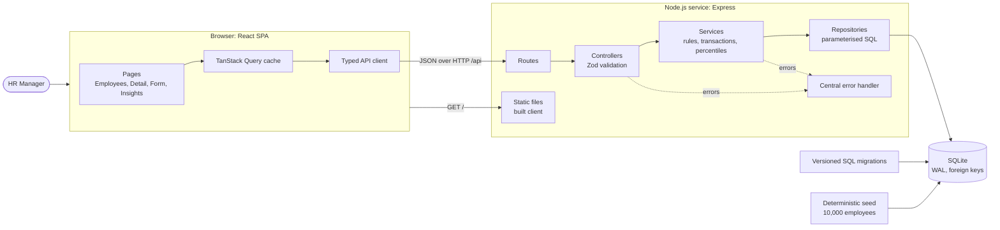
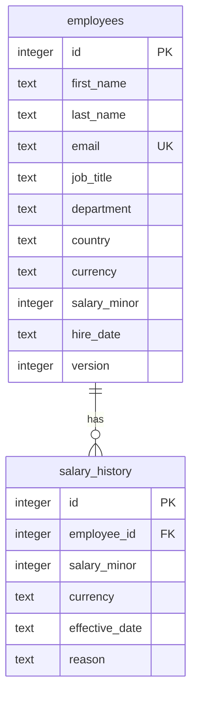

# Architecture

One Node.js service. In production it serves both the JSON API and the built React app, so the
whole product deploys as a single process with a SQLite file on a persistent disk. In development,
Vite serves the client and proxies `/api` to the server.

## Data model

## Request flow: changing a salary

1. The client posts `{ salaryMinor, currency, effectiveDate, reason, version }` to
   `/api/employees/:id/salary-changes`.
2. The controller validates the id and body with Zod.
3. The service opens a transaction, checks the currency and effective date against the employee,
   inserts the history row, recomputes the current salary from history and bumps the version
   (`WHERE id = ? AND version = ?`).
4. A stale version or missing employee throws a domain error, the transaction rolls back and the
   central handler returns a 409 or 404 in the standard error shape.
5. On success the client invalidates the employee, history, list and insights queries.

## Layer rules

- Routes only wire paths to controllers.
- Controllers parse input and shape output; they hold no SQL and no business rules.
- Services own business rules and transactions and depend on repository functions.
- Repositories are the only code that touches the database.
- Shared pure logic (percentiles, bands, money) has no I/O, so it is unit-tested directly.
